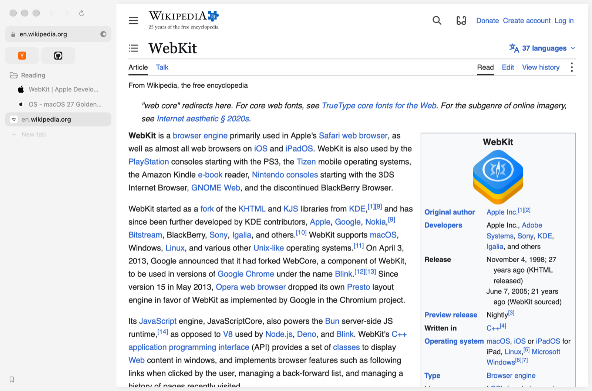
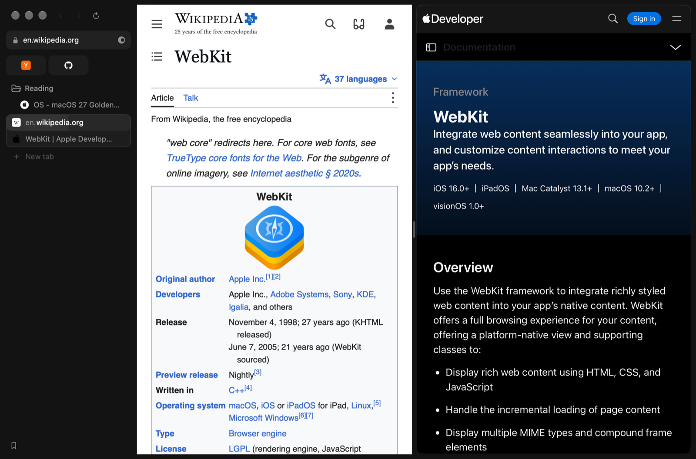

# roko for Mac

A small, fast and quiet browser for the Mac, built on WebKit, the engine already inside every Mac.
It is the companion to [roko on iPhone](https://github.com/vibe-karlo/roko-browser): the same
blocking, the same answers in the address bar, and your read-later list, to-dos and shopping list
kept in step between the two.





## What it does

- **⌘T opens the launcher** over the page you're on, as in Arc: open tabs, history, bookmarks,
  commands, quick answers (sums, units, currencies, dates, the time somewhere) and search, in one
  field. It learns what you pick, so "lin" goes to the page you mean.
- **Tabs down the side or across the top**, with spaces, pinned tabs, folders inside folders, and
  Split View with up to three pages.
- **Blocking, as on iPhone**: ads, trackers and annoyances blocked by WebKit's own content rules,
  and cookie notices answered with "reject".
- **Summarize Page and Browse for Me**: a summary beside the page, or a question answered from the
  web with sources. Written by Apple Intelligence on your Mac, or by Claude with your own key.
- **With roko on iPhone**: Read Later, to-dos and shopping lists synced through roko's sync key, and
  iCloud history for builds signed with your own team.
- **Notify Me** watches a page and tells you when it changes in a way that matters.
- **From Arc and Dia**: links from other apps open in the right space, Little Windows, Peek, link
  previews with Shift, Tidy Tabs, a clean Copy Link, a frame tinted by the site, and Arc's keyboard
  shortcuts, all changeable in Settings.
- **Passwords** in the macOS keychain, imported from Chrome, Arc, Dia, Brave or Edge.
- **Chrome extensions** on WebKit's own extension engine.
- **An app icon of your choice**, kept in the Dock after quitting.
- **roko Shield for Dia**: the same blocking as a Chrome extension, for Dia or any other Chromium
  browser ([ShieldExtension](ShieldExtension/README.md)).

The [changelog](CHANGELOG.md) lists everything that has changed since roko split from Search.

## Build it

macOS 27 or later, with the Xcode 27 / Swift 6 toolchain.

```bash
swift build               # the binary
./build.sh                # build/roko.app, signed with your Apple Development certificate if you have one
SEARCH_DEV=1 ./build.sh   # a dev build, on a yellow icon
swift test --parallel     # the tests, about a minute
```

Passkeys and iCloud history need a provisioning profile from your own Apple Developer team: put
your team ID in `roko.passkeys.entitlements` and `roko.icloud.entitlements` (they say
`YOUR_TEAM_ID`) and place the profiles next to `build.sh`. Without them roko builds and runs, just
without those two features.

Summaries and Browse for Me need Apple Intelligence, or a Claude API key added in Settings. Keys are
kept in your keychain, never in the repository.

The scripts and environment variables (`SEARCH_DEV`, `SEARCH_PROBE`, `./bench`) keep Search's
names. `./bench` drives a running test build from the shell; `fresh.sh` opens a copy with its own
settings and data, apart from the browser you use.

## Where it comes from

roko for Mac started as a fork of [Search](https://github.com/driceroland/Search) by Office
Commun, on 30 October 2026. Search's history is kept in this repository; roko's own work is on top.

## License

MIT, see [LICENSE](LICENSE). Search's copyright notice stays with the code it wrote.
